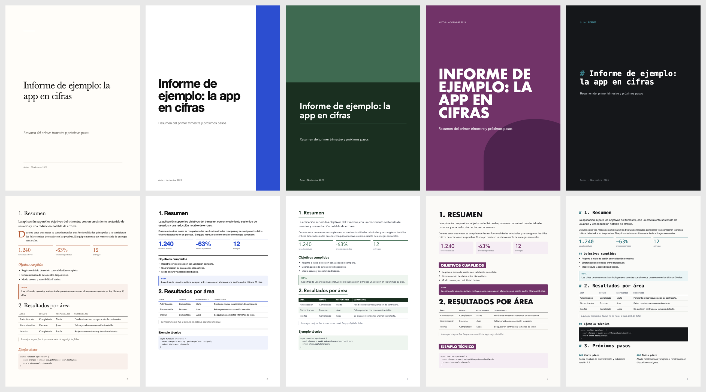
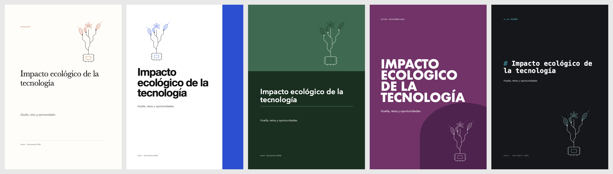

[Español](README.md) · **English**

# pdf-polish

A Claude Code skill that **redesigns the presentation of a PDF or document** without touching its content. Built for when the text is fine but Claude keeps producing the same design, colors and structure.

- 5 themes × 7 palettes, with automatic rotation so each PDF looks different from the last.
- Customizable body font, title font and colors.
- **Custom illustrated cover** based on the document's topic (optional).
- **Automatic whitespace and layout check** before delivering.
- Nothing to install: it renders with Chrome (or Brave/Chromium) on macOS.

## Requirements
- macOS with Google Chrome, Brave or Chromium in `/Applications`.
- Xcode command line tools (`swift`), used for the layout check and image export.
- Claude Code.

## Installation

```bash
git clone https://github.com/ackedev/pdf-polish.git ~/.claude/skills/pdf-polish
```

Open a new Claude Code session so it loads the skill.

## How to use it

Give Claude the PDF (or the markdown/text) and ask for the skill by name. Everything you add is optional; whatever you leave out, the skill decides.

> The skill's instructions are written in Spanish, so the phrase it reacts to is "Aplica la skill pdf-polish". Asking for it by name in English (`pdf-polish`) also works.

### The minimum
> Aplica la skill pdf-polish a `report.pdf`

It will ask up to 3 questions (purpose, tone, whether you want a cover) and generate the PDF.

### Everything specified
> Aplica la skill pdf-polish a `report.pdf`
> - Body font: Georgia
> - Title font: Futura
> - Colors: red and orange
> - With cover

### More examples
- "Apply pdf-polish to these markdown notes, editorial style, green tones, no cover."
- "Apply pdf-polish, you decide the design." (no questions asked)
- "Do it again with another theme" / "Same design but in blue." (only re-runs the render)

### What you get
1. The new PDF.
2. The theme, palette and fonts chosen, with the reason.
3. If there is a cover, what the illustration represents.

## Custom cover
If you ask for a cover, the skill **does not use a generic image**: it summarizes what your document is about and designs an illustration that merges the topic with its field into a single figure, subtle and with a double reading. For example, for a report on the environmental impact of technology: a plant whose stem and branches are circuit traces, with organic leaves and a flower made of pads (see `examples/cover-art/plant-circuit.svg`). The method is described in [`cover-art.md`](cover-art.md).

## Whitespace check
Before delivering, the skill runs `scripts/check_layout.swift`, which measures, per page, the word count, how far the content reaches and the largest internal gap. If it detects half-empty pages, stray page breaks, large gaps or an unusually low density, it diagnoses the cause, fixes the HTML and renders again.

## Colors and fonts
- `--accent`: main color. `--accent2`: **dark** tone (cover backgrounds). Ask for "red and orange" and the skill turns it into hex values with contrast in mind (for example vivid orange + dark red).
- Only fonts installed on your Mac work; if one is missing, the skill warns you and suggests a similar one.
- Safe fonts: Palatino, Baskerville, Georgia, Didot, Avenir Next, Futura, Optima, Gill Sans, Helvetica Neue, Menlo.

## Manual use (without Claude)
```bash
S=~/.claude/skills/pdf-polish
bash $S/scripts/pick.sh                      # suggests "theme palette"
bash $S/scripts/render.sh --theme editorial --palette forest \
     --in body.html --out output.pdf         # body.html = only the contents of <body>
swift $S/scripts/check_layout.swift output.pdf --cover
```
`render.sh` options: `--theme`, `--palette`, `--accent`, `--accent2`, `--font-body`, `--font-title`, `--in`, `--out`.

## Structure
```
SKILL.md              instructions for Claude (in Spanish)
cover-art.md          how to design the cover illustration
base.css              print rules and shared components
themes/               editorial · swiss · corporate · bold · mono
palettes/palettes.css 7 palettes
scripts/              render.sh · pick.sh · check_layout.swift · pdf2png.swift · pdf2text.swift · hasfont.swift
examples/             sample content and cover illustration
```

## Known limits
- macOS only (Chrome + PDFKit).
- Starting from a PDF recovers the text, not the images or the exact table structure; a scanned PDF will not work.
- Claude writes the design in HTML each time: with very long or unusual content, check the result.
- Fonts limited to system fonts (no Google Fonts) so it works offline.

## Adding themes or palettes
- Theme: copy a `.css` from `themes/`, change the `[data-theme="…"]` selector and the variables; keep the `.cover-art` rules.
- Palette: add one line to `palettes/palettes.css`.

## Gallery
The same content with the 5 themes (left to right: `editorial`, `swiss`, `corporate`, `bold`, `mono`): cover on top, interior page below.



### With an illustrated cover
If you ask for a cover, the skill designs an illustration tailored to the document. Here, a report on the environmental impact of technology: a plant whose stem and branches are circuit traces. The drawing recolors itself to match the theme and palette.



## License
MIT © 2026 Aleix Garcia Pena. See [`LICENSE`](LICENSE).
