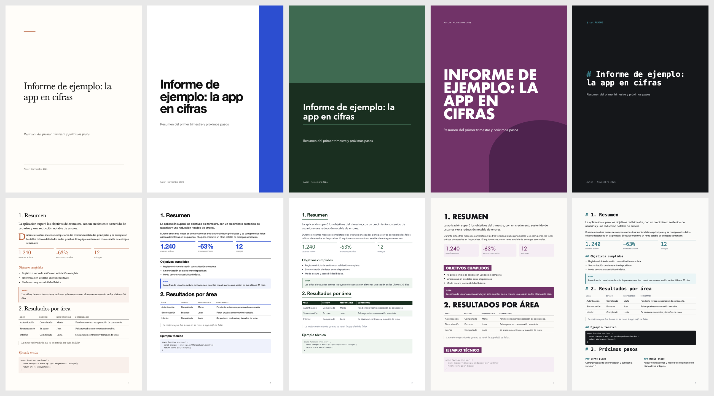
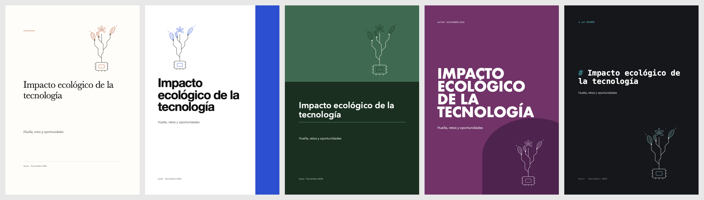

**Español** · [English](README.md)

# pdf-polish

Skill para Claude Code que **rediseña la presentación de un PDF o documento** sin tocar su contenido. Pensada para cuando el texto está bien pero Claude siempre genera el mismo diseño, color y estructura.

- 5 temas × 7 paletas, con rotación automática para no repetir el aspecto del último PDF.
- Fuente, fuente de títulos y colores personalizables.
- **Portada ilustrada a medida** del tema del documento (opcional).
- **Revisión automática de huecos en blanco** y de maquetación antes de entregar.
- Sin dependencias que instalar: renderiza con Chrome (o Brave/Chromium) en macOS.

## Requisitos
- macOS con Google Chrome, Brave o Chromium en `/Applications`.
- Herramientas de línea de comandos de Xcode (`swift`), para la revisión y la exportación a imagen.
- Claude Code.

## Instalación

```bash
git clone https://github.com/ackedev/pdf-polish.git ~/.claude/skills/pdf-polish
```

Abre una sesión nueva de Claude Code para que la cargue.

## Cómo usarla

Pasa el PDF (o el markdown/texto) y pide la skill por su nombre. Todo lo que añadas es opcional; lo que no digas lo decide la skill.

> Funciona en español y en inglés: pídela por su nombre ("Aplica la skill pdf-polish…" / "Apply the pdf-polish skill…") y Claude responde en tu idioma.

### Lo mínimo
> Aplica la skill pdf-polish a `informe.pdf`

Te hará hasta 3 preguntas (para qué es, tono, si quieres portada) y generará el PDF.

### Con todo especificado
> Aplica la skill pdf-polish a `informe.pdf`
> - Fuente del texto: Georgia
> - Fuente de títulos: Futura
> - Colores: rojo y naranja
> - Con portada

### Más ejemplos
- "Aplica pdf-polish a estas notas en markdown, estilo editorial, tonos verdes, sin portada."
- "Aplica pdf-polish, tú decide el diseño." (no hará preguntas)
- "Hazlo otra vez con otro tema" / "Mismo diseño pero en azul." (repite solo el render)

### Qué recibes
1. El PDF nuevo.
2. Tema, paleta y fuentes elegidos, con el motivo.
3. Si hay portada, qué representa la ilustración.

## Portada a medida
Si pides portada, la skill **no usa una imagen genérica**: resume de qué trata tu documento y diseña una ilustración que une el tema con su ámbito en una sola figura, sutil y con doble lectura. Por ejemplo, para un informe sobre el impacto ecológico de la tecnología: una planta cuyo tallo y ramas son pistas de circuito, con hojas orgánicas y una flor hecha de pads (ver `examples/cover-art/plant-circuit.svg`). La metodología está en [`cover-art.md`](cover-art.md).

## Revisión de huecos en blanco
Antes de entregar, la skill ejecuta `scripts/check_layout.swift`, que mide por página las palabras, hasta dónde llega el contenido y el mayor hueco interno. Si detecta páginas medio vacías, saltos de página sobrantes, huecos grandes o una densidad anormalmente baja, diagnostica la causa, corrige el HTML y vuelve a renderizar.

## Colores y fuentes
- `--accent`: color principal. `--accent2`: tono **oscuro** (fondos de portada). Pide "rojo y naranja" y la skill lo traduce a hex con criterio de contraste (por ejemplo naranja vivo + rojo oscuro).
- Solo funcionan fuentes instaladas en el Mac; si no existe, la skill avisa y propone una parecida.
- Fuentes seguras: Palatino, Baskerville, Georgia, Didot, Avenir Next, Futura, Optima, Gill Sans, Helvetica Neue, Menlo.

## Uso manual (sin Claude)
```bash
S=~/.claude/skills/pdf-polish
bash $S/scripts/pick.sh                      # sugiere "tema paleta"
bash $S/scripts/render.sh --theme editorial --palette forest \
     --in cuerpo.html --out salida.pdf       # cuerpo.html = solo el contenido del <body>
swift $S/scripts/check_layout.swift salida.pdf --cover
```
Opciones de `render.sh`: `--theme`, `--palette`, `--accent`, `--accent2`, `--font-body`, `--font-title`, `--in`, `--out`.

## Estructura
```
SKILL.md              instrucciones para Claude
cover-art.md          cómo diseñar la ilustración de portada
base.css              impresión y componentes comunes
themes/               editorial · swiss · corporate · bold · mono
palettes/palettes.css 7 paletas
scripts/              render.sh · pick.sh · check_layout.swift · pdf2png.swift · pdf2text.swift · hasfont.swift
examples/             contenido de ejemplo e ilustración de portada
```

## Límites conocidos
- Solo macOS (Chrome + PDFKit).
- Partir de un PDF recupera el texto, no las imágenes ni la estructura exacta de las tablas; un PDF escaneado no sirve.
- El diseño lo escribe Claude en HTML cada vez: con contenidos muy largos o poco habituales conviene revisar el resultado.
- Fuentes limitadas a las del sistema (sin Google Fonts) para funcionar sin conexión.

## Añadir temas o paletas
- Tema: copia un `.css` de `themes/`, cambia el selector `[data-theme="…"]` y las variables; mantén las reglas `.cover-art`.
- Paleta: una línea nueva en `palettes/palettes.css`.

## Galería
Mismo contenido con los 5 temas (de izquierda a derecha: `editorial`, `swiss`, `corporate`, `bold`, `mono`): portada arriba, página interior abajo.



### Con portada ilustrada
Si pides portada, la skill diseña una ilustración a medida del documento. Aquí, un informe sobre el impacto ecológico de la tecnología: una planta cuyo tallo y ramas son pistas de circuito. El dibujo se recolorea solo según el tema y la paleta.



## Licencia
MIT © 2026 Aleix Garcia Pena. Consulta [`LICENSE`](LICENSE).
